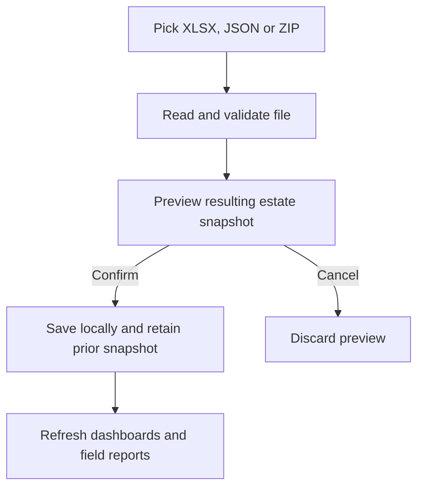

# Planters Book architecture

This guide describes the offline data paths in this checkout. Start with [developer setup](../README.md#developer-setup) for build instructions.

## App entry points

| Platform | Start here |
| --- | --- |
| Android | [MainActivity.kt](../app/src/main/java/com/selendang3/app/MainActivity.kt) starts the Compose app and owns its navigation routes. The root observes the Room estate snapshot and passes the parsed data to the estate dashboard, field details and upkeep screens. The Crop Production screen observes the same snapshot directly. |
| iPhone and iPad | [Selendang3App.swift](../ios/Selendang3/Selendang3App.swift) launches [HomeView.swift](../ios/Selendang3/Features/Home/HomeView.swift). SwiftUI report views observe the shared estate reference store. |

## Source layout

| Platform | Screen folders | Shared code |
| --- | --- | --- |
| Android | `app/src/main/java/com/selendang3/app/features/` contains `estate`, `fields`, `upkeep`, `production`, `settings` and `tools`. | The root package contains startup, navigation and shared UI. The `data` package contains models, imports, storage and calculations. |
| iPhone and iPad | `ios/Selendang3/Features/` contains `Home`, `Estate`, `Fields`, `Upkeep`, `Production`, `Settings` and `Tools`. | The `Selendang3` root contains the app entry point, shared components, models and stores. XcodeGen includes the feature folders through the `Selendang3` source directory. |

## Estate file to report

| Stage | Android | iPhone and iPad |
| --- | --- | --- |
| Pick and preview | [EstateDataScreen.kt](../app/src/main/java/com/selendang3/app/features/estate/EstateDataScreen.kt) handles the file picker, preview and confirmation in Settings. | [UserSettingsView.swift](../ios/Selendang3/Features/Settings/UserSettingsView.swift) handles the file picker, preview and confirmation. |
| Decode and validate | [EstateZip.kt](../app/src/main/java/com/selendang3/app/data/EstateZip.kt) detects the format, delegates workbook conversion to [EstateXlsx.kt](../app/src/main/java/com/selendang3/app/data/EstateXlsx.kt), and uses [EstatePackage.kt](../app/src/main/java/com/selendang3/app/data/EstatePackage.kt) to parse and validate snapshot JSON. | [EstateZip.swift](../ios/Selendang3/EstateZip.swift) detects the format, delegates workbook conversion to [EstateXlsx.swift](../ios/Selendang3/EstateXlsx.swift), and uses [EstateReference.swift](../ios/Selendang3/EstateReference.swift) to parse and validate snapshot JSON. |
| Confirm and store | [EstateUpdates.kt](../app/src/main/java/com/selendang3/app/data/EstateUpdates.kt) checks that the saved snapshot still matches the preview and writes the current and previous snapshots in one Room transaction. [EstateDatabase.kt](../app/src/main/java/com/selendang3/app/data/EstateDatabase.kt) exposes the saved snapshot through a Room flow. | [EstateReferenceStore.swift](../ios/Selendang3/EstateReferenceStore.swift) checks that the saved snapshot still matches the preview, writes the previous and current JSON files in Application Support using atomic file writes, and publishes the new reference. |
| Read and display | [OperationalDashboardScreen.kt](../app/src/main/java/com/selendang3/app/features/estate/OperationalDashboardScreen.kt) and [FieldDetailsScreen.kt](../app/src/main/java/com/selendang3/app/features/fields/FieldDetailsScreen.kt) display dashboard and field data. [ProductionScreen.kt](../app/src/main/java/com/selendang3/app/features/production/ProductionScreen.kt) uses [CropProductionTable.kt](../app/src/main/java/com/selendang3/app/data/CropProductionTable.kt) for crop totals, budgets and field summaries. | [HomeDashboardSummaryView.swift](../ios/Selendang3/Features/Home/HomeDashboardSummaryView.swift) and [FieldDetailsView.swift](../ios/Selendang3/Features/Fields/FieldDetailsView.swift) display dashboard and field data. [ProductionView.swift](../ios/Selendang3/Features/Production/ProductionView.swift) uses [CropProductionTableData.swift](../ios/Selendang3/CropProductionTableData.swift) for crop totals, budgets and field summaries. |

JSON and XLSX imports replace the full snapshot. A versioned ZIP can also replace selected sections and reports when its base revision matches the saved snapshot. The preview shows the complete result before any write. Reviewed restore swaps the current snapshot with the previous one. See the [workbook and JSON contract](data-updates.md), [ZIP and restore contract](estate-zip.md) and [fictional sample JSON](../sample-data/estate-update.example.json).

## Manual production drafts

Full manual entry forms are planned. The retained draft model and stores provide the save path for a caller that supplies a draft. The stores validate the draft and replace any existing entry with the same date and field. The crop reports shown today read the imported estate snapshot. Estate ZIP export and snapshot restore cover the snapshot and its optional reports. Drafts are stored separately.

| Platform | Draft model and validation | Local save path |
| --- | --- | --- |
| Android | [Production.kt](../app/src/main/java/com/selendang3/app/data/Production.kt) | [ProductionDraftStore.kt](../app/src/main/java/com/selendang3/app/data/ProductionDraftStore.kt) saves versioned records in SharedPreferences under `production_drafts_v1`. |
| iPhone and iPad | [ProductionData.swift](../ios/Selendang3/ProductionData.swift) | [ProductionStore.swift](../ios/Selendang3/ProductionStore.swift) writes versioned records to `production-drafts-v1.json` in Application Support. |

## Where to verify a change

| Area | Android | iPhone and iPad |
| --- | --- | --- |
| Import formats | [EstatePackageTest](../app/src/test/java/com/selendang3/app/data/EstatePackageTest.kt), [EstateXlsxTest](../app/src/test/java/com/selendang3/app/data/EstateXlsxTest.kt), [EstateZipTest](../app/src/test/java/com/selendang3/app/data/EstateZipTest.kt) | [EstateReferenceChecks](../ios/Tests/EstateReferenceChecks.swift), [EstateXlsxChecks](../ios/Tests/EstateXlsxChecks.swift), [EstateZipChecks](../ios/Tests/EstateZipChecks.swift) |
| Saved snapshots | [DatabaseUpdateTest](../app/src/androidTest/java/com/selendang3/app/DatabaseUpdateTest.kt), an instrumentation test covered by the [APK policy](android-apk-policy.md) | [EstateZipChecks](../ios/Tests/EstateZipChecks.swift) exercises backup and restore against the disk store. |
| Dashboard and field calculations | [HomeDashboardDataTest](../app/src/test/java/com/selendang3/app/data/HomeDashboardDataTest.kt), [FieldDetailsDataTest](../app/src/test/java/com/selendang3/app/data/FieldDetailsDataTest.kt), [FieldCropSummaryTest](../app/src/test/java/com/selendang3/app/data/FieldCropSummaryTest.kt) | [EstateDashboardChecks](../ios/Tests/EstateDashboardChecks.swift) |
| Production drafts | [ProductionTest](../app/src/test/java/com/selendang3/app/data/ProductionTest.kt), [ProductionDraftStoreTest](../app/src/androidTest/java/com/selendang3/app/ProductionDraftStoreTest.kt), an instrumentation test | [ProductionChecks](../ios/Tests/ProductionChecks.swift) |
